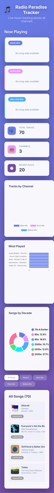

# Radio Paradise Tracker

A Java 25 + Spring Boot application that continuously tracks currently playing songs on Radio Paradise channels and exposes the data through a REST API.

## Features

- Polls Radio Paradise API on a fixed interval (every 30 seconds by default)
- Stores songs in a persistent PostgreSQL database
- Tracks per-song play counts and last played timestamps
- Exposes browsing endpoints for all, recent, most-played, and channel-filtered songs
- Includes a Vue.js dashboard frontend with charts and channel-based views
- Opens song details from live cards, lists, charts, tracks, and playback history, with large artwork,
  listening statistics, and lyrics from [LRCLIB](https://lrclib.net/docs) when available
- Uses bounded JVM caches for RP reads and internal list/page responses (30-second TTL)

## Architecture

- **Backend:** Spring Boot (`src/main/java`)
  - Scheduled polling with `SongTrackerScheduler`
  - External API integration with `RadioParadiseClient`
  - Persistence via Spring Data JPA + PostgreSQL
- **Frontend:** Vue 3 + Vite (`frontend`)
  - Live dashboard cards for each channel
  - Most-played and distribution charts
  - Filterable song list

## Quick Start

### Full Docker stack

Install Docker with the Compose plugin, then run:

```bash
docker compose up -d --build --wait
```

Open [http://localhost:8080](http://localhost:8080). The dashboard and `/api` share this address. No local Java, Maven, or Node installation is required: the image builds Vue, runs the backend tests, and packages the frontend into Spring Boot.

The stack contains:

- `app`: Java 25 / Spring Boot, running as a non-root user with a database-aware health check.
- `postgres`: PostgreSQL 17 with persistent data in the `postgres-data` volume.
- `caddy`: HTTP entrypoint and automatic HTTPS when configured with a public domain. Certificates persist in `caddy-data`.

Only Caddy publishes ports. PostgreSQL and Spring Boot are accessed over the internal Docker network. Defaults bind the website to localhost. Configuration overrides can be placed in a local `.env` file, starting from `.env.example`.

`APP_TIMEZONE` defaults to `Europe/Istanbul` for application logs. Song and playback timestamps use absolute instants stored as PostgreSQL `timestamp with time zone`; the API returns UTC and the UI displays the browser's timezone. Existing databases with timezone-less song columns require the [timestamp migration](docs/records-api.md#storage-and-migration) before starting the updated application.

```bash
docker compose ps
docker compose logs --tail=100 app
docker compose exec app curl -fsS http://localhost:8081/actuator/health
docker compose down
```

`docker compose down` retains the database and certificate volumes. **Adding `-v` deletes the stored data.** Do not run a second backend against the same database: each backend instance runs its own song collector.

### Development without application containers

To run Maven and Vite directly, start only PostgreSQL with the optional host port mapping. Stop a running containerized backend first to avoid duplicate collectors:

```bash
docker compose stop app caddy
```

### 1) Start PostgreSQL

With Docker installed and running:

```bash
docker compose -f compose.yaml -f compose.dev.yaml up -d --wait postgres
```

This starts PostgreSQL 17 on `localhost:5432` with database, username, and password all set to `radioparadise` by default for local development. Data survives container and application restarts. If you configured custom credentials in `.env`, export the same values before starting Maven; Spring Boot does not automatically load Docker Compose's `.env` file.

### 2) Start the backend

```bash
./mvnw spring-boot:run
```

Backend runs on `http://localhost:8081`.

### 3) Start the frontend (optional dashboard)

```bash
npm --prefix frontend install
npm --prefix frontend run dev
```

Frontend runs on `http://localhost:3000`.

## Deploy to a server

Use a Linux VM with Docker/Compose and a domain whose DNS records point to that VM. A 4 GB RAM VM is a reasonable starting point for this stack. Clone this repository onto the server and copy `.env.example` to `.env`. Set:

```dotenv
DB_USERNAME=radioparadise
DB_PASSWORD=replace-with-a-long-random-password
APP_TIMEZONE=Europe/Istanbul
SITE_ADDRESS=radio.example.com
BIND_ADDRESS=0.0.0.0
HTTP_PORT=80
HTTPS_PORT=443
```

Use your actual domain and a unique password before the database's first startup. Allow incoming TCP ports 80 and 443 through the server/provider firewall, and restrict SSH access. Keep database and application ports unpublished. Then start the stack:

```bash
docker compose up -d --build --wait
```

Caddy obtains and renews the domain's HTTPS certificate automatically. For an update, pull the latest code and run the same Compose command. For database backups, schedule `pg_dump` and copy the output off the VM; Docker volumes alone are not backups.

The image build runs all backend tests. Internal health is available through `docker compose exec app curl -fsS http://localhost:8081/actuator/health`; Caddy returns 404 for public `/actuator/*` requests. Health checks report failures, while `restart: unless-stopped` restarts containers when their processes exit.

Known tracking limitation: the collector remembers the last song per channel in memory. Restarting the backend can count a currently playing song again; Dockerization does not change that behavior.

## API Endpoints

- `GET /api/songs` - List all tracked songs
- `GET /api/songs/current` - Latest observed song per channel, from our database
- `GET /api/songs/{id}` - Song details and on-demand, persisted lyrics metadata
- `GET /api/songs/recent` - List latest 20 songs by `lastPlayed`
- `GET /api/songs/most-played` - List top 20 songs by `playCount`
- `GET /api/songs/channel/{channelId}` - Filter songs by channel (`0`, `1`, `2`)

### Channel IDs

- `0` -> Main Mix
- `1` -> Mellow Mix
- `2` -> Rock Mix

### Song details and caching

The collector is the only caller of RP. Its client caches each channel for 30 seconds,
including empty/error results to avoid retry storms. Dashboard lists cache seven response
variants; track and playback pages each cache at most 128 validated queries. Cached values
are DTO snapshots, and concurrent cache misses share a load. Caches expire 30 seconds after
loading and reset on application restart. HTTP responses use `Cache-Control: no-store` so
browser/CDN caching does not add another TTL. Polling, server TTLs, and browser polling can
add delay; these are interval settings, not a guarantee of exactly 30 seconds end to end.

Only the three live cards refresh every 30 seconds. Browsing lists, charts, record filters,
scroll position, focus, and the selected modal stay stable. Hidden browser tabs skip polling.
Lists/charts reload on returning from Records; Records has an explicit Refresh button.

Opening a song looks up its exact artist/title/album in LRCLIB, with a 2-second connection
timeout and 4-second read timeout. Lyrics, source URL, duration, status, and check time are
stored on the song. Successful/instrumental results refresh after 30 days, missing results
after one day, and provider failures after five minutes. Previously saved lyrics survive
temporary provider errors. Large/medium/small RP artwork URLs are retained when collected.
Existing database rows work immediately; nullable enrichment columns are added by Hibernate
and populated as songs are opened or observed again. Lyrics are excluded from list responses.
Set `lyrics.api.base-url` to override the provider URL in a test environment.

## Development guidelines and checks

Java changes follow the repository's [coding guidelines](AGENTS.md), adapted from
the chatty-bot backend rules. Keep existing API behavior, transaction boundaries,
cache semantics, and collector metrics intact when refactoring.

Run the backend checks with Java 25:

```bash
./mvnw -B -ntp verify
```

Database integration tests require Docker and run against a disposable PostgreSQL
instance via `bash scripts/test-records-postgres.sh`. Ordinary Maven runs skip these tests.
For frontend changes, run `npm --prefix frontend test` and
`npm --prefix frontend run build`.

## Configuration

All core settings are in `src/main/resources/application.properties`:

- `server.port=8081`
- `radioparadise.api.base-url=https://api.radioparadise.com`
- `radioparadise.api.channels=0,1,2`
- `radioparadise.scheduler.fixed-delay=30000`

## Database Configuration

The backend uses these environment variables, with defaults matching the local Docker setup:

| Variable | Default |
| --- | --- |
| `DB_URL` | `jdbc:postgresql://localhost:5432/radioparadise` |
| `DB_USERNAME` | `radioparadise` |
| `DB_PASSWORD` | `radioparadise` |

To use an existing PostgreSQL server, create the database and a user with permission to create and update tables, then export these variables before starting the backend. Use your own credentials outside local development. Docker Compose also reads `DB_USERNAME` and `DB_PASSWORD`; changing them after the database volume has been initialized does not update the existing database credentials.

Hibernate creates or updates the schema on startup (`spring.jpa.hibernate.ddl-auto=update`) and retains tables on shutdown. The previous H2 database was in memory, so it has no on-disk data to migrate. Switching a running instance does not transfer its in-memory songs.

For local database inspection:

```bash
docker compose exec postgres sh -c 'psql -U "$POSTGRES_USER" -d "$POSTGRES_DB"'
```

## Screenshots

### Dashboard Overview


### Dashboard Mobile View



## Tech Stack

- Java 25
- Spring Boot
- Spring Data JPA
- PostgreSQL
- Lombok
- Maven
- Vue 3
- Vite
- Chart.js
