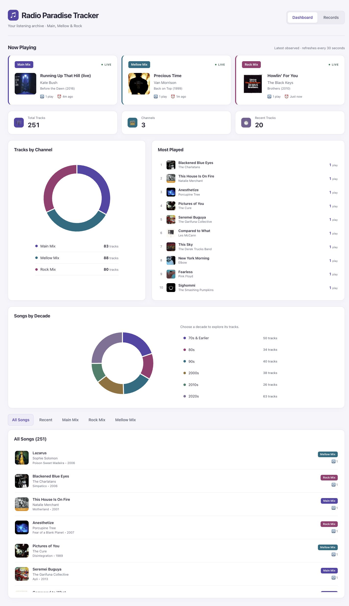
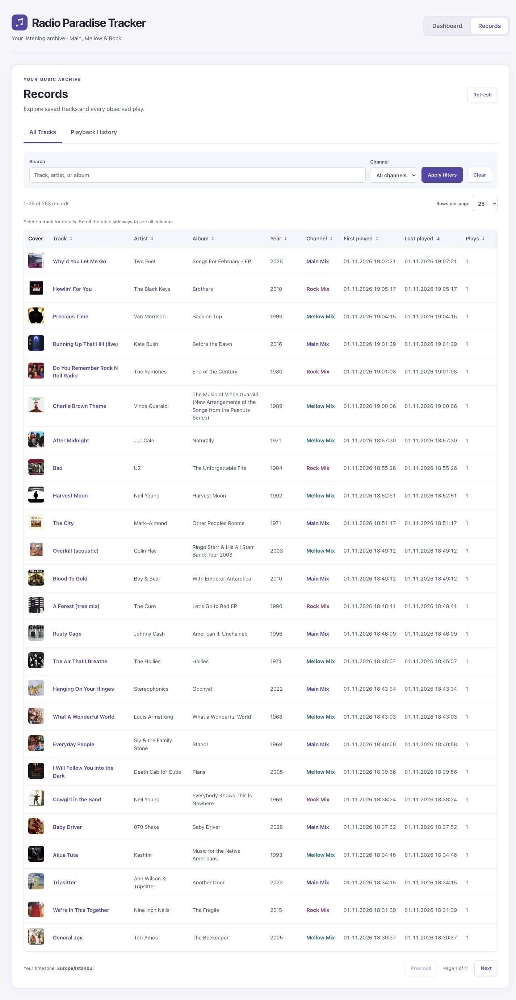
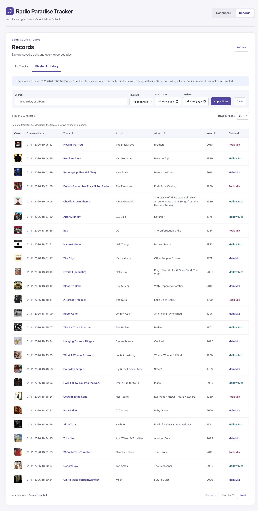
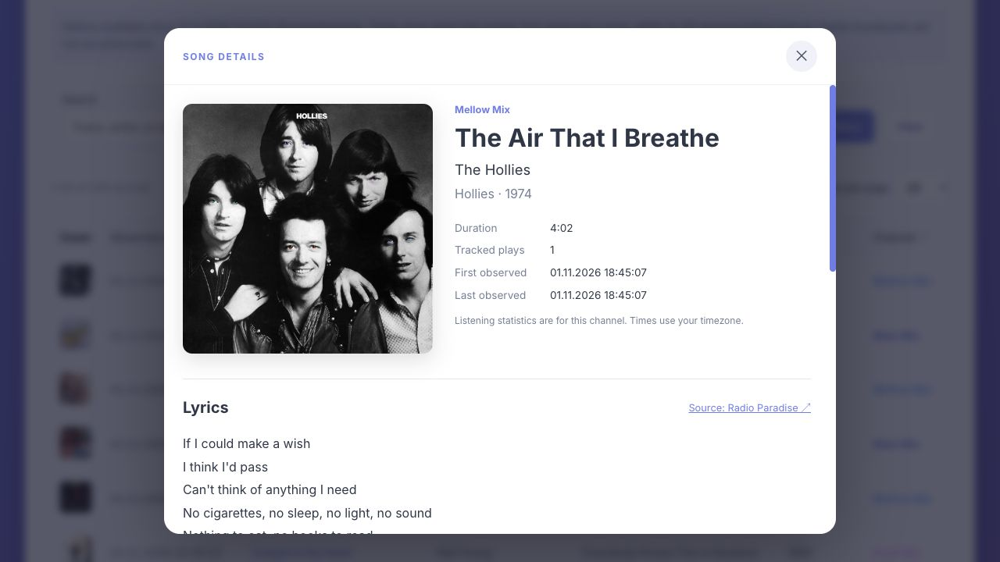
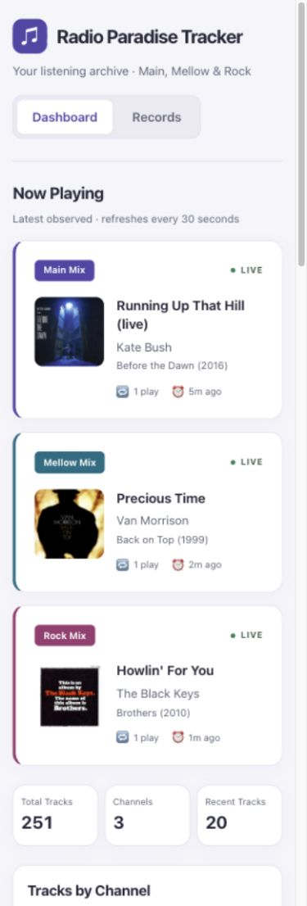

# Radio Paradise Tracker

**Unofficial Radio Paradise Tracker**

This is an independent, non-commercial, open-source project created for music discovery and historical playback statistics.

This project is not affiliated with, endorsed by, or officially connected to Radio Paradise.

Radio Paradise and its trademarks belong to their respective owners. Music metadata is provided for informational purposes.

Visit [Radio Paradise](https://radioparadise.com/) to listen to the original broadcasts.

A Java 25 + Spring Boot application with a Vue 3 dashboard that continuously tracks songs on Radio Paradise's Main, Mellow, and Rock mixes, stores observed playback history, and exposes the data through a REST API.

## Features

- Polls Radio Paradise API on a fixed interval (every 30 seconds by default)
- Stores songs in a persistent PostgreSQL database
- Tracks per-song play counts and last played timestamps
- Persists playback events and a per-channel checkpoint so an ongoing play is not counted again after a restart
- Exposes browsing endpoints for all, recent, most-played, and channel-filtered songs
- Includes a responsive Vue dashboard with live channel cards, channel distribution, most-played tracks, and songs by decade
- Provides a Records page with searchable, sortable, paginated tracks and playback history, plus channel and history date filters
- Displays timestamps and interprets history date filters in the browser's timezone
- Opens song details from live cards, lists, charts, tracks, and playback history, with large artwork,
  listening statistics, and lyrics directly from Radio Paradise when available
- Uses bounded JVM caches for RP reads and internal list/page responses (30-second TTL)
- Uses system typography, accessible channel colors, keyboard-accessible track rankings and decade controls, and artwork placeholders for unavailable covers
- Offers an optional Grafana, Prometheus, and Loki stack for metrics and logs

## Architecture

- **Backend:** Spring Boot (`src/main/java`)
  - Scheduled polling with `SongTrackerScheduler`
  - External API integration with `RadioParadiseClient`
  - Persistence via Spring Data JPA + PostgreSQL
  - Transactional song statistics and playback events with restart-safe deduplication
- **Frontend:** Vue 3 + Vite (`frontend`)
  - Live dashboard cards for each channel
  - Most-played ranking, channel distribution, and decade charts
  - Filterable song list
  - Records tables and song-details modal

## Explore the app

- **Dashboard** (`/#/`): see the latest observed song for each channel, browse song lists, and explore charts.
- **Records → All Tracks** (`/#/records`): search by track, artist, or album; filter by channel; sort columns; and choose 25, 50, or 100 rows per page.
- **Records → Playback History** (`/#/records?tab=plays`): browse individual observed plays and filter by calendar dates in your timezone. Filters, sorting, and pagination are preserved in the URL.
- **Song details**: select a song card, list entry, chart track, or Records title/artwork to see larger artwork, channel-specific listening statistics, duration, and available Radio Paradise lyrics.

History records when the tracker first observed a play, within its polling interval. Earlier broadcasts are not reconstructed, and downtime can leave gaps. See the [Records API guide](docs/records-api.md) for query parameters and storage details.

## Quick Start

### Full Docker stack

Install Docker with the Compose plugin, then run:

```bash
docker compose up -d --build --wait
```

Open [http://localhost:8080](http://localhost:8080). The dashboard and `/api` share this address. No local Java, Maven, or Node installation is required: the image tests and builds Vue, runs the backend tests, and packages the frontend into Spring Boot. PostgreSQL integration tests run separately.

The stack contains:

- `app`: Java 25 / Spring Boot, running as a non-root user with a database-aware health check.
- `postgres`: PostgreSQL 17 with persistent data in the `postgres-data` volume.
- `caddy`: HTTP entrypoint and automatic HTTPS when configured with a public domain. Certificates persist in `caddy-data`.

Caddy publishes the website ports, and PostgreSQL publishes `127.0.0.1:5432` for local clients or SSH tunneling. Spring Boot is accessible only over the internal Docker network. Defaults bind the website to localhost. Configuration overrides can be placed in a local `.env` file, starting from `.env.example`.

`APP_TIMEZONE` defaults to `Europe/Istanbul` for application logs. Song and playback timestamps use absolute instants stored as PostgreSQL `timestamp with time zone`; the API returns UTC and the UI displays the browser's timezone. Existing databases with timezone-less song columns require the [timestamp migration](docs/records-api.md#storage-and-migration) before starting the updated application.

```bash
docker compose ps
docker compose logs --tail=100 app
docker compose exec app curl -fsS http://localhost:8081/actuator/health
docker compose down
```

`docker compose down` retains the database and certificate volumes. **Adding `-v` deletes the stored data.** Do not run a second backend against the same database: each backend instance runs its own song collector.

### Development without application containers

To run Maven and Vite directly, start only PostgreSQL with its loopback host port mapping. Stop a running containerized backend first to avoid duplicate collectors:

```bash
docker compose stop app caddy
```

### 1) Start PostgreSQL

With Docker installed and running:

```bash
docker compose -f compose.yaml -f compose.dev.yaml up -d --wait postgres
```

This starts PostgreSQL 17 on `localhost:5432` with database, username, and password all set to `radioparadise` by default for local development. Data survives container and application restarts. If you configured custom credentials in `.env`, export the same values before starting Maven; Spring Boot does not automatically load Docker Compose's `.env` file.

### 2) Start the backend

```bash
./mvnw spring-boot:run
```

Backend runs on `http://localhost:8081`. Use Java 25; the Maven wrapper supplies Maven.

### 3) Start the frontend (optional dashboard)

```bash
npm --prefix frontend install
npm --prefix frontend run dev
```

Frontend runs on `http://localhost:3000` and proxies `/api` to the backend. Node.js 24 is used by CI and Docker. See the [frontend guide](frontend/README.md) for components and UI behavior.

## Deploy to a server

Use a Linux VM with Docker/Compose and a domain whose DNS records point to that VM. A 4 GB RAM VM is a reasonable starting point for this stack. Clone this repository onto the server and copy `.env.example` to `.env`. Set:

```dotenv
DB_USERNAME=radioparadise
DB_PASSWORD=replace-with-a-long-random-password
APP_TIMEZONE=Europe/Istanbul
SITE_ADDRESS=radio.example.com
BIND_ADDRESS=0.0.0.0
HTTP_PORT=80
HTTPS_PORT=443
```

Use your actual domain and a unique password before the database's first startup. Allow incoming TCP ports 80 and 443 through the server/provider firewall, and restrict SSH access. Keep PostgreSQL bound to loopback and the application port unpublished. Then start the stack:

```bash
docker compose up -d --build --wait
```

Caddy obtains and renews the domain's HTTPS certificate automatically. For an update, pull the latest code and run the same Compose command. For database backups, schedule `pg_dump` and copy the output off the VM; Docker volumes alone are not backups.

The image build runs backend unit tests and frontend checks; database integration tests run separately. Internal health is available through `docker compose exec app curl -fsS http://localhost:8081/actuator/health`; Caddy returns 404 for public `/actuator/*` requests. Health checks report failures, while `restart: unless-stopped` restarts containers when their processes exit.

The latest persisted playback event per channel prevents a restart from counting the same ongoing play twice. Full replays during downtime cannot be inferred when the same track is still current after recovery.

For the existing Oracle VM, GHCR image deployment, production approval, and rollback workflow, see the [deployment guide](docs/oracle-deployment.md). The optional monitoring stack and Grafana dashboards are covered in the [observability setup](observability/README.md) and [operations guide](docs/observability.md).

## API Endpoints

- `GET /api/songs` - List all tracked songs
- `GET /api/songs/current` - Latest observed song per channel, from our database
- `GET /api/songs/{id}` - Song details and on-demand, persisted lyrics metadata
- `GET /api/songs/recent` - List latest 20 songs by `lastPlayed`
- `GET /api/songs/most-played` - List top 20 songs by `playCount`
- `GET /api/songs/channel/{channelId}` - Filter songs by channel (`0`, `1`, `2`)
- `GET /api/records/tracks` - Search, filter, sort, and paginate saved tracks
- `GET /api/records/plays` - Search, filter, sort, and paginate observed playback events

Records endpoints accept `page`, `size`, `sort`, `direction`, `q`, and `channel`.
Playback history also accepts `from`, `to`, and `timeZone`. See the
[Records API reference](docs/records-api.md) for defaults, response shapes,
validation, and examples.

### Channel IDs

- `0` -> Main Mix
- `1` -> Mellow Mix
- `2` -> Rock Mix

### Song details and caching

The collector polls RP’s richer `/api/nowplaying_list_v2022?mode=wip-channel` feed. Its client caches each channel for 30 seconds,
including empty/error results to avoid retry storms. Dashboard lists cache seven response
variants; track and playback pages each cache at most 128 validated queries. Cached values
are DTO snapshots, and concurrent cache misses share a load. Caches expire 30 seconds after
loading and reset on application restart. HTTP responses use `Cache-Control: no-store` so
browser/CDN caching does not add another TTL. Polling, server TTLs, and browser polling can
add delay; these are interval settings, not a guarantee of exactly 30 seconds end to end.

Only the three live cards refresh every 30 seconds. Browsing lists, charts, record filters,
scroll position, focus, and the selected modal stay stable. Hidden browser tabs skip polling.
Lists/charts reload on returning from Records; Records has an explicit Refresh button.

Opening a song fetches RP’s own `/siteapi.php?file=music::song&song_id=...` endpoint,
with a 2-second connection timeout and 4-second read timeout. RP song IDs and duration
are collected from the live feed. Existing rows resolve their ID by exact artist/title/album
matching against the same cached recent history (up to 100 songs per channel); rows outside that history gain an ID
when they play again. No account credentials or external lyrics provider are used.

RP’s lyrics HTML is converted to plain text before storage and display. Lyrics, RP song ID,
source URL, duration, status, and check time persist in PostgreSQL. Successful/instrumental
results refresh after 30 days, missing results after one day, and provider failures after
five minutes. A bounded 256-entry, 30-second client cache also coalesces detail lookups.
Previously saved RP lyrics survive temporary RP errors. Results from the earlier provider
are replaced on the next opening, regardless of their old TTL.

Large/medium/small RP artwork URLs are retained when collected. Existing rows remain
valid; Hibernate adds the nullable RP ID column. Lyrics stay out of list responses.
`radioparadise.api.base-url` configures both RP clients for local tests.

Song details also resolve recording identifiers and streaming links through the
[MusicBrainz API](https://musicbrainz.org/doc/MusicBrainz_API), without Spotify/Google credentials.
The lookup requires an exact normalized artist credit, title, and album, plus duration
within three seconds. It rejects video recordings, nonempty recording disambiguation,
multiple matching recordings, truncated search results, and conflicting ISRCs. This favors
missed matches over linking a different performance or version. A catalog match is an
automatic metadata match, not manual verification or proof of playback availability.

The optional ISRC, MusicBrainz recording source, match status, Spotify/YouTube Music URLs,
and check time persist in nullable columns added by Hibernate's existing schema update.
Direct links are accepted only from active streaming relationships on the matched recording:
Spotify track URLs and explicit `music.youtube.com/watch` URLs. Ordinary YouTube video links
are not converted to YouTube Music links. Recording-level link and ISRC coverage is incomplete;
this version does not query Spotify or YouTube Music by ISRC. Search buttons remain available
for each service without an accepted direct link. Artist/album links are never used as track links.

Lookups run only when opening song details, outside playback transactions, after RP duration
enrichment. Matches refresh after 30 days; absent, ambiguous, or incomplete matches after a day;
temporary failures after five minutes. Previously accepted metadata survives temporary failures.
A bounded 256-entry, 30-second cache coalesces catalog loads, including across channels.
MusicBrainz requests are spaced at least 1.1 seconds apart per application instance, with
2-second connection and 4-second read timeouts. Multiple instances sharing an outbound IP
need a shared rate limiter before enabling catalog traffic on all instances.
`musicbrainz.api.base-url` (or `MUSICBRAINZ_API_BASE_URL`) can select a test server or mirror.
No keys are needed; public API use is subject to MusicBrainz's usage terms.

### Backfill existing recording identifiers

The `recording-backfill` profile runs a one-off maintenance pass without an HTTP server
or playback collector, then closes the application context. It scans stable ID pages of
up to 50 songs, bounded by the highest ID at startup. Existing ISRCs are skipped.
Each song uses the ordinary details path to recover RP duration/IDs where possible and
persist catalog results without changing plays or listening counters. Lookup TTLs and
MusicBrainz rate limiting apply; unavailable catalog lookups do not stop subsequent songs.
Database failures fail the job rather than reporting success. A rerun reuses persisted
lookup outcomes; `--recording.backfill.after-id=123` can explicitly resume after an ID.
The default per-pass limit is 10,000, configurable with `--recording.backfill.limit`.

```bash
java -jar target/radio-paradise-tracker-1.0.0.jar --spring.profiles.active=recording-backfill
java -jar target/radio-paradise-tracker-1.0.0.jar --spring.profiles.active=recording-backfill --recording.backfill.retry-errors-only=true
```

The second command retries only rows whose latest catalog lookup was `unavailable`,
including previously accepted matches retained through an outage. It does not repeatedly
query ambiguous or missing recordings every day. Old rows without sufficient RP metadata
remain unresolved until that metadata becomes available; search buttons still work.

On the Oracle host, `scripts/run-recording-backfill.sh /absolute/path/backfill.jar missing`
runs the maintenance JAR using the live application's Java runtime image, database
environment, and Docker network. The live app is not replaced. Use `errors` for retries.
`compose.recording-backfill.yaml` disables the web health check for the worker, which
has no HTTP listener.
The script uses `flock` and one worker container to prevent overlap. Do not start another
catalog worker on the same outbound IP while a pass is running.

The production systemd units in `scripts/systemd/` run error retries daily at **04:00
Europe/Istanbul**. `Persistent=true` catches a missed run after downtime. They expect the
maintenance JAR at `/home/ubuntu/rparadise-maintenance/recording-backfill.jar` and the script
in the deployed repository directory. After copying the units to `/etc/systemd/system/`:

```bash
sudo systemctl daemon-reload
sudo systemctl enable --now rparadise-recording-retry.timer
sudo systemctl list-timers rparadise-recording-retry.timer
sudo journalctl -u rparadise-recording-retry.service
```

The deployment workflow copies the healthy release's JAR into the maintenance directory
and updates/enables the timer, keeping its schema and matching logic aligned with the app. The
timer runs independently of the playback collector; catalog/network failures cannot stop
collection. A failed maintenance run is visible in systemd/journald and the timer retries
on the next daily run. Take a database backup before the initial schema update/backfill.

## Development guidelines and checks

Java changes follow the repository's [coding guidelines](AGENTS.md), adapted from
the chatty-bot backend rules. Keep existing API behavior, transaction boundaries,
cache semantics, and collector metrics intact when refactoring.

Run the backend checks with Java 25:

```bash
./mvnw -B -ntp verify
```

Database integration tests require Docker and run against a disposable PostgreSQL
instance via `bash scripts/test-records-postgres.sh`. Ordinary Maven runs skip these tests.
For frontend changes, run `npm --prefix frontend test` and
`npm --prefix frontend run build`.

## Configuration

All core settings are in `src/main/resources/application.properties`:

- `server.port=8081`
- `radioparadise.api.base-url=https://api.radioparadise.com`
- `radioparadise.api.channels=0,1,2`
- `radioparadise.scheduler.fixed-delay=30000`

## Database Configuration

The backend uses these environment variables, with defaults matching the local Docker setup:

| Variable | Default |
| --- | --- |
| `DB_URL` | `jdbc:postgresql://localhost:5432/radioparadise` |
| `DB_USERNAME` | `radioparadise` |
| `DB_PASSWORD` | `radioparadise` |

To use an existing PostgreSQL server, create the database and a user with permission to create and update tables, then export these variables before starting the backend. Use your own credentials outside local development. Docker Compose also reads `DB_USERNAME` and `DB_PASSWORD`; changing them after the database volume has been initialized does not update the existing database credentials.

Hibernate creates or updates the schema on startup (`spring.jpa.hibernate.ddl-auto=update`) and retains tables on shutdown. The previous H2 database was in memory, so it has no on-disk data to migrate. Switching a running instance does not transfer its in-memory songs.

For local database inspection:

```bash
docker compose exec postgres sh -c 'psql -U "$POSTGRES_USER" -d "$POSTGRES_DB"'
```

## Screenshots

Captured from the updated frontend on November 1, 2026, using the running API. Songs and totals change as collection continues.

### Dashboard Overview



### Records — All Tracks

<details>
<summary>Show searchable tracks and listening statistics</summary>



</details>

### Playback History

<details>
<summary>Show playback events and date filters</summary>



</details>

### Song Details



### Dashboard Mobile View



## Tech Stack

- Java 25
- Spring Boot
- Spring Data JPA
- PostgreSQL
- Lombok
- Maven
- Vue 3
- Vite
- Chart.js

## License and third-party content

The project's original source code and documentation are licensed under the
[MIT License](LICENSE).

The description of this project as non-commercial refers to how the project is
operated. The MIT License permits commercial reuse of the licensed code.

Third-party content is not covered by this project's MIT License. This includes
album artwork, lyrics, music metadata, audio, logos, trademarks, and third-party
content visible in repository screenshots. This project claims no ownership of
that content and grants no rights to it. Any rights remain with their respective
owners, and use is subject to applicable terms and permissions.

Third-party software dependencies retain their own licenses.
